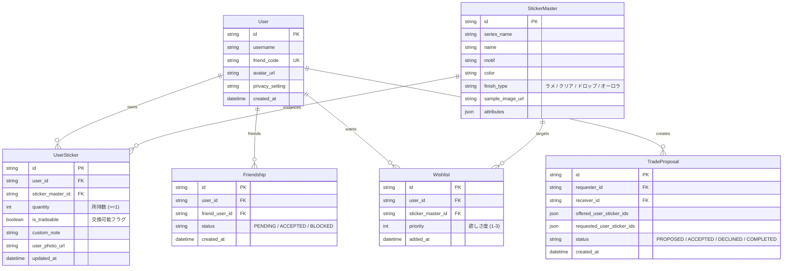

# システム設計書 (Architecture Design)
**プロジェクト名:** ボンドロシール帳 (BonDrop Sticker Book)  
**バージョン:** 1.0.0  
**ステータス:** Approved  

---

## 1. システム全体構成 (System Overview)

本システムは、モバイルでの快適な写真撮影・閲覧体験を提供する**モダンWeb/PWAフロントエンド**、シールコレクションおよびフレンド関係を管理する**バックエンドAPI**、そしてシールの自動認識・特徴抽出を担う**Google Gemini 3.8 Flash マルチモーダルエンジン**で構成される。

```mermaid
flowchart TD
    subgraph Client ["Client (Mobile / PWA)"]
        UI["UI / シール帳ビュー (React + Tailwind + Framer Motion)"]
        Cam["カメラ撮影 & 画像前処理 (Canvas / Web Workers)"]
        Cache["オフラインキャッシュ (IndexedDB)"]
    end

    subgraph Backend ["Backend API Service"]
        Auth["認証 & フレンド管理"]
        StickerMgr["シール台帳 & コレクション管理"]
        MatchEngine["トレード & プレゼント マッチングエンジン"]
        GeminiProxy["Gemini API プロキシ & プロンプト制御"]
    end

    subgraph AI ["Google GenAI (Gemini)"]
        GeminiFlash["Gemini 3.8 Flash (Multimodal)"]
    end

    subgraph Storage ["Database & Storage"]
        DB[(RDBMS / Firestore)]
        Blob[("画像ストレージ (GCS / Cloudflare R2 / S3)")]
    end

    Cam -->|写真アップロード| GeminiProxy
    GeminiProxy -->|画像 + JSONスキーマ| GeminiFlash
    GeminiFlash -->|認識結果 (構造化JSON)| GeminiProxy
    GeminiProxy -->|ドラフトシールデータ| UI
    UI -->|確定・保存| StickerMgr
    StickerMgr --> DB
    UI <-->|フレンド台帳取得 & マッチング要求| MatchEngine
    MatchEngine --> DB
```

---

## 2. 推奨技術スタック (Technology Stack)

| レイヤー | 技術選定 | 選定理由 |
|---|---|---|
| **フロントエンド** | React 19 / Next.js (App Router) + TypeScript | 高速レンダリング、SSR/SSG、APIルート統合、PWA対応の容易さ |
| **スタイリング / UI** | Tailwind CSS + Lucide Icons + Framer Motion | シール特有の「ぷっくり光沢（Drop Shadow / Glossy）」デザインとページめくり演出の実現 |
| **マルチモーダルAI** | Google Gemini 3.8 Flash (`@google/genai` SDK) | 画像認識の速度・コスパが最優秀。Structured Outputsによる確実なJSON出力 |
| **データベース** | Supabase (PostgreSQL) または SQLite (Prisma / Drizzle) | リレーショナル構造（ユーザー、所持シール、フレンド、トレード）と柔軟なクエリ |
| **画像ストレージ** | Cloudflare R2 / Google Cloud Storage | 低コストで高速なシール写真・切り出しサムネイル配信 |

---

## 3. データモデル設計 (Data Models / ERD)



---

## 4. Geminiマルチモーダル画像認識の設計 (Vision AI Pipeline)

### 4.1 プロンプト＆Structured Output定義
ユーザーが撮影したシールの写真から、正確に特徴を抽出し既存のマスターデータとマッピング可能にするため、Geminiの `responseSchema` を用いた構造化出力を行う。

```typescript
// Gemini API 呼び出し構造化スキーマ例
export const StickerRecognitionSchema = {
  type: "object",
  properties: {
    stickers: {
      type: "array",
      items: {
        type: "object",
        properties: {
          name_candidate: { type: "string", description: "シールの名称・愛称 (例: ぷっくりイチゴドロップ)" },
          series_candidate: { type: "string", description: "シリーズ名 (推測可能なら記載)" },
          motif: { 
            type: "string", 
            enum: ["ハート", "星", "スイーツ", "動物", "フラワー", "ジュエリー", "キャラクター", "その他"],
            description: "主要なモチーフ" 
          },
          primary_color: { type: "string", description: "メインカラー (例: パステルピンク, ミントグリーン)" },
          finish_type: { 
            type: "string", 
            enum: ["クリアドロップ", "ラメ入り", "オーロラ", "パール", "ぷっくりマット"],
            description: "シールの質感・加工タイプ" 
          },
          estimated_count: { type: "integer", description: "写真内に写っている同一シールの枚数" },
          confidence_score: { type: "number", description: "認識の確信度 (0.0 - 1.0)" }
        },
        required: ["name_candidate", "motif", "primary_color", "finish_type", "estimated_count"]
      }
    }
  },
  required: ["stickers"]
};
```

---

## 5. トレード＆プレゼント・マッチングロジック (Matching Algorithm)

### 5.1 プレゼント判定 (Gift Finder Logic)
ユーザーAがフレンドBのシール帳を見ている場合：
1. ユーザーAの所持リストの中で `quantity >= 2`（ダブり）かつ `is_tradeable == true` のシール群を取得（集合 `A_Duplicates`）。
2. フレンドBの所持リスト（集合 `B_Owned`）および欲しいものリスト（集合 `B_Wishlist`）を取得。
3. **プレゼント推奨リスト:**
   - 最優先（★Wishlist一致）: `A_Duplicates ∩ B_Wishlist`
   - 推奨（未所持解消）: `A_Duplicates \ B_Owned` （Aがダブっており、Bが未所持のもの）

### 5.2 相互トレードマッチング (Mutual Trade Matcher Logic)
ユーザーAとフレンドBの双方が得をする交換組み合わせの自動算出：
- 候補ペア:
  - AがBへ提供可能: `Tradeables_A = { s ∈ A | A.quantity > 1 ∧ A.is_tradeable ∧ s ∉ B_Owned }`
  - BがAへ提供可能: `Tradeables_B = { s ∈ B | B.quantity > 1 ∧ B.is_tradeable ∧ s ∉ A_Owned }`
- `Tradeables_A` と `Tradeables_B` が共に1件以上存在する場合、**「1対1交換可能」**としてサジェスト通知・バッジ表示。

---

## 6. セキュリティ & プライバシー設計 (Security & Privacy)

1. **アクセス制御 (Row Level Security / Authorization):**
   - ユーザーは自身のコレクションの作成・更新・削除のみ可能。
   - 他ユーザーのシール帳は、`Friendship.status == 'ACCEPTED'` である場合、または全体公開設定がONの場合のみ閲覧許可。
2. **AIエンドポイントの保護:**
   - レートリミット（1ユーザーあたり1分間に最大5回の画像解析）を設定し、Gemini APIの乱用やコスト高騰を防止。
   - アップロード画像は一時処理後にサイズ圧縮し、個人が特定できる写り込み（顔など）は検出時に警告または切り落とし。
