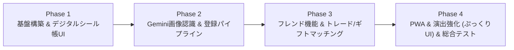

# 実装計画書 (Implementation Plan)
**プロジェクト名:** ボンドロシール帳 (BonDrop Sticker Book)  
**バージョン:** 1.0.0  
**ステータス:** Approved  

---

## 1. 開発フェーズ構成 (Development Phases)

Antigravity SDD（Spec-Driven Development）に則り、以下の4フェーズで段階的に実装と検証を進める。

---

## 2. フェーズ詳細とマイルストーン

### Phase 1: 基盤構築 & デジタルシール帳UI (Core Foundation & Sticker Book UI)
- **目標:** ユーザーが手動でシールを登録・編集でき、可愛いシール帳デザインで閲覧・ステータス管理ができる最小動作環境（MVP）の構築。
- **成果物:**
  - プロジェクト基盤（Next.js / TypeScript / Tailwind CSS / Prisma or SQLite/Supabase）のセットアップ。
  - シールマスターおよび所持シール（UserSticker）のCRUD API。
  - シール帳画面（ぷっくりドロップスタイル、グリッド/リスト切り替え、ダブりバッジ、Wishlistトグル）。
  - ダブり枚数（quantity >= 2）の自動フラグ処理。

### Phase 2: Geminiマルチモーダル画像認識パイプライン (AI Vision Pipeline)
- **目標:** 写真を撮影・アップロードすると、Gemini 2.5 Flashがシールを自動認識し、候補一覧として編集・確定できる機能の実装。
- **成果物:**
  - カメラ撮影・画像アップロード用フロントエンドコンポーネント。
  - Gemini API Route (`/api/stickers/recognize`) の実装（`@google/genai` 連携、Structured Outputs）。
  - 認識結果レビュー＆一括登録モーダル（名称修正、枚数、モチーフ、カラーの編集）。
  - 画像リサイズおよび圧縮処理（APIコスト削減・転送速度向上）。

### Phase 3: フレンド機能 & トレード/ギフトマッチングエンジン (Social & Trade Matcher)
- **目標:** フレンド登録を行い、相手のシール帳を閲覧し、プレゼントや交換の最適な候補を自動提示する。
- **成果物:**
  - フレンドコード生成・検索・申請・承認機能。
  - フレンドのシール帳閲覧ビュー（権限制御：未承認ユーザーには非公開）。
  - **Gift Finder (プレゼント支援):** 「相手が持っていない自分のダブりシール」の抽出＆ハイライト。
  - **Smart Trade Matcher (交換支援):** 「自分が出せるシール ⇄ 相手が出せるシール」の相互マッチングアルゴリズム。
  - トレード提案リクエストの作成・共有UI。

### Phase 4: PWA・演出強化 & 総合検証 (Polish & Verification)
- **目標:** 実物のシール帳のような触感（ぷっくり感、光沢シェーダー、ページめくり音・アニメーション）、PWA化、E2Eテスト。
- **成果物:**
  - Framer Motion によるシール貼り付け＆めくり演出。
  - モバイルPWAマニフェスト、サービスワーカー、オフラインキャッシュ。
  - 受入基準（DoD）に基づく結合テスト・シナリオテスト実施。

---

## 3. 検証・テスト戦略 (Verification & Testing Strategy)

1. **ユニットテスト (Vitest / Jest):**
   - マッチングアルゴリズムの厳密な集合演算（A_Duplicates ∩ B_Wishlist、相互交換可能なペア算出）をテスト。
   - 所持数変更に伴う「ダブり・交換可能」フラグの整合性検証。
2. **モックによるAIパイプライン検証:**
   - 開発・CI環境ではGemini APIのモックレスポンスを用意し、API課金を消費せずにUIレビュー画面のE2Eテストを自動化。
3. **実機モバイルテスト:**
   - スマートフォン（iOS Safari / Android Chrome）でのカメラ起動、ファイル選択、レスポンシブ表示を検証。
